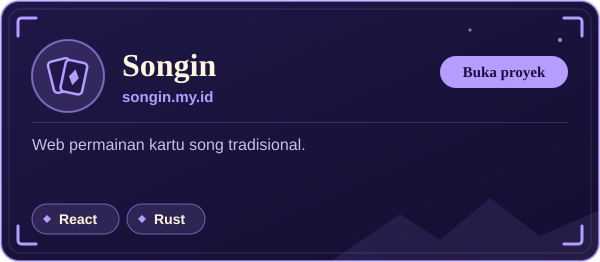
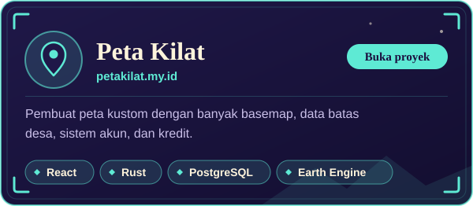
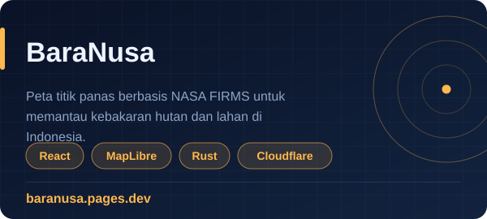
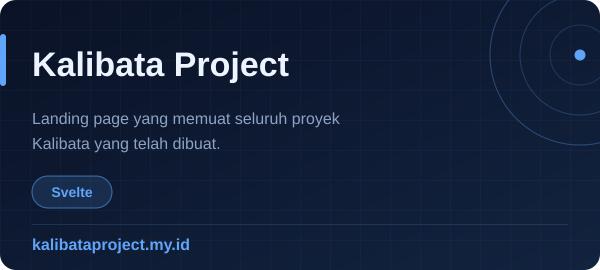

### Player Status
* **Class:** `Tech Explorer`
* **Guild:** `Universitas Bengkulu (Informatics)`
* **Base Camp:** `Bengkulu, Indonesia`
* **Main Weapons:** `Rust` · `React` · `Cloudflare`
* **Currently:** Membangun peta interaktif dan aplikasi data geospasial untuk Indonesia

### Featured Projects

<table>
  <tr>
    <td align="center">
      
    </td>
    <td align="center">
      
    </td>
  </tr>
  <tr>
    <td align="center">
      
    </td>
    <td align="center">
      
    </td>
  </tr>
</table>

### Tech Stack

**Backend** 

 

**Frontend** 

 

**Cloud and Deployment** 

 

**Networking** 

 

**GIS and Spatial Data** 

 

**Data Science and AI** 

### Active Quests
- **Main Quest:** Merancang arsitektur aplikasi web modern yang *scalable* dengan Rust di backend dan React di frontend.
- **Exploration:** Menganalisis dan mengekstraksi wawasan dari data geospasial (NASA, Copernicus, Sentinel/TROPOMI via GEE).
- **Side Quest:** Mendalami ekosistem Cloudflare (Pages, Workers, edge deployment).
- **Leveling Up:** Meningkatkan keahlian di bidang algoritma serta analitik data.
- **AFK Zone:** Pushing rank di Mobile Legends: Bang Bang.

### GitHub Stats

  

  
<b>Connect</b>

  
  

    

  

