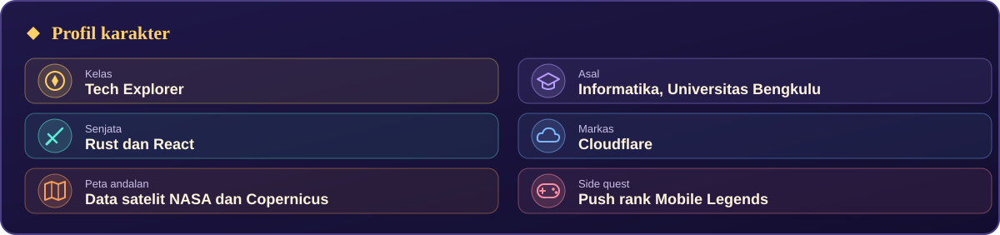

 

Halo, saya Ricardo 👋 Mahasiswa Informatika yang hobi menjelajah dunia lewat kode. Hari-hari saya diisi dengan membangun aplikasi web pakai **Rust** dan **React**, lalu mengirimnya ke **Cloudflare**. Bahan favorit saya adalah data satelit dari NASA dan Copernicus, yang saya ubah jadi peta yang bisa dipakai siapa saja.

Kalau lagi butuh istirahat dari layar kode, saya pindah ke layar lain: push rank di Mobile Legends.

### Proyek

### Stack

### Kontak

Email: [ricardogellael48@gmail.com](mailto:ricardogellael48@gmail.com) 
LinkedIn: [ricardo-gellael](https://www.linkedin.com/in/ricardo-gellael-86303a401)

 

