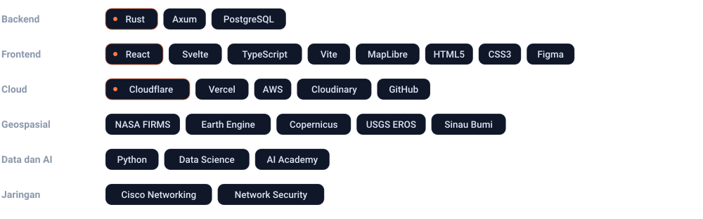

 

Mahasiswa Informatika di Universitas Bengkulu. Saya membangun aplikasi web dengan **Rust** dan **React**, men-deploy-nya di **Cloudflare**, dan banyak bekerja dengan data geospasial dari NASA dan Copernicus.

Di luar layar, saya push rank di Mobile Legends.

 

### Proyek

 

### Stack

 

### Kontak

Email: [ricardogellael48@gmail.com](mailto:ricardogellael48@gmail.com) 
LinkedIn: [ricardo-gellael](https://www.linkedin.com/in/ricardo-gellael-86303a401)

 

